# MindRise Database Architecture & Schema Specification

This document details the PostgreSQL schema, relational architecture, privacy safeguards, and deletion lifecycle for **MindRise** (SRS v1.3), managed via Prisma ORM (`@mindrise/database`).

---

## 1. Architectural Overview & Two-Layer Identity Model

MindRise operates on a foundational trust principle: **Confidentiality is a clinical prerequisite**. Due to societal stigma surrounding mental distress among Ethiopian youth, users must be confident that their real-world identities will never be exposed socially, while the platform maintains strict verification controls to prevent duplicate account abuse and trolling.

```
                           +-------------------------+
                           |       User (Auth)       |
                           |   (UUID, Status, Role)  |
                           +-------------------------+
                                        |
                 +----------------------+----------------------+
                 | (1:1 Private)                               | (1:1 Public)
                 v                                             v
+----------------------------------+          +----------------------------------+
|         VerifiedIdentity         |          |             Profile              |
|----------------------------------|          |----------------------------------|
| - firstName, lastName            |          | - anonymousHandle (case-insens.) |
| - phoneEncrypted, emailEncrypted |          | - avatarUrl (Supabase Storage)   |
| - phoneHash, emailHash (HMAC)    |          | - bio                            |
| - verifiedAt                     |          +----------------------------------+
|----------------------------------|                           |
| RESTRICTED: Anti-Sybil / Audit   |                           | Public Community
| NEVER visible to peers/mods!     |                           v
| On Delete: CASCADE (Purged)      |          +----------------------------------+
+----------------------------------+          |        Posts, Comments, etc.     |
                 |                            +----------------------------------+
                 v
+----------------------------------+
|        IdentityAccessLog         |
|  (Audit trail of all PII access) |
+----------------------------------+
```

---

## 2. Mermaid Entity-Relationship (ER) Diagram

```mermaid
erDiagram
    User ||--o| VerifiedIdentity : "1:1 private"
    User ||--o| Profile : "1:1 public"
    User ||--o{ VerificationCode : "has"
    User ||--o{ IdentityAccessLog : "accesses"
    VerifiedIdentity ||--o{ IdentityAccessLog : "audited by"
    User ||--o{ AssessmentAttempt : "submits"
    AssessmentTemplate ||--o{ AssessmentQuestion : "contains"
    AssessmentTemplate ||--o{ AssessmentAttempt : "evaluates"
    User ||--o{ Routine : "tracks"
    Routine ||--o{ RoutineCompletion : "records"
    User ||--o| UserProgress : "earns"
    User ||--o{ UserBadge : "awarded"
    Badge ||--o{ UserBadge : "granted to"
    Topic ||--o{ Post : "categorizes"
    User ||--o{ Post : "authors"
    Post ||--o{ Comment : "contains"
    User ||--o{ Comment : "authors"
    Post ||--o{ Reaction : "receives"
    User ||--o{ Reaction : "gives"
    User ||--o{ Report : "reports"
    User ||--o{ CrisisFlag : "triggers (SetNull on delete)"
    AssessmentAttempt ||--o| CrisisFlag : "flags"
    Post ||--o| CrisisFlag : "flags"
    User ||--o{ ModerationAction : "targeted by (SetNull on delete)"
    User ||--o{ ModerationAction : "moderates"
    User ||--o{ AutoRestriction : "restricted by (SetNull on delete)"

    User {
        uuid id PK
        enum role
        enum status
        enum preferredLanguage
        datetime deletedAt
        datetime createdAt
        datetime updatedAt
    }

    VerifiedIdentity {
        uuid id PK
        uuid userId FK,UK
        string firstName
        string lastName
        string phoneEncrypted
        string emailEncrypted
        string phoneHash
        string emailHash
        datetime verifiedAt
        datetime createdAt
        datetime updatedAt
    }

    VerificationCode {
        uuid id PK
        uuid userId FK
        enum channel
        string codeHash
        datetime expiresAt
        int attempts
        datetime consumedAt
    }

    Profile {
        uuid id PK
        uuid userId FK,UK
        string anonymousHandle UK
        string avatarUrl
        string bio
        datetime createdAt
        datetime updatedAt
    }

    IdentityAccessLog {
        uuid id PK
        uuid accessedById FK
        uuid targetIdentityId FK
        string action
        string reason
        string ipAddress
        string userAgent
        datetime createdAt
    }

    AssessmentTemplate {
        uuid id PK
        enum domain UK
        string titleEn
        string titleAm
        int version UK
        int riskThreshold
    }

    AssessmentQuestion {
        uuid id PK
        uuid templateId FK
        string textEn
        string textAm
        int order
        boolean isRiskItem
        json scoring
    }

    AssessmentAttempt {
        uuid id PK
        uuid userId FK
        uuid templateId FK
        json answers
        int score
        string summaryKey
        boolean riskFlagged
    }

    Routine {
        uuid id PK
        uuid userId FK
        string title
        string description
        enum status
        datetime deletedAt
    }

    StarterRoutine {
        uuid id PK
        string titleEn
        string titleAm
        string category
    }

    RoutineCompletion {
        uuid id PK
        uuid routineId FK
        date completedDate UK
        datetime createdAt
    }

    UserProgress {
        uuid id PK
        uuid userId FK,UK
        int points
        int currentStreak
        int longestStreak
        date lastCompletedDate
    }

    Badge {
        uuid id PK
        string slug UK
        string nameEn
        string nameAm
        int pointsRequired
    }

    UserBadge {
        uuid id PK
        uuid userId FK,UK
        uuid badgeId FK,UK
        datetime awardedAt
    }

    Topic {
        uuid id PK
        string slug UK
        string nameEn
        string nameAm
    }

    Post {
        uuid id PK
        uuid authorId FK
        uuid topicId FK
        string title
        string content
        boolean isPinned
        datetime deletedAt
    }

    Comment {
        uuid id PK
        uuid postId FK
        uuid authorId FK
        string content
        datetime deletedAt
    }

    Reaction {
        uuid id PK
        uuid postId FK,UK
        uuid userId FK,UK
        enum type UK
    }

    Report {
        uuid id PK
        uuid reporterId FK
        enum targetType
        uuid targetId
        string reason
        enum status
    }

    CrisisFlag {
        uuid id PK
        uuid userId FK
        enum source
        enum priority
        enum status
        datetime userAcknowledgedAt
    }

    CrisisResource {
        uuid id PK
        string nameEn
        string nameAm
        string phone
        boolean isActive
        datetime lastVerifiedAt
    }

    ModerationAction {
        uuid id PK
        uuid moderatorId FK
        uuid targetUserId FK
        string targetHandleSnapshot
        enum type
        string reason
    }

    AutoRestriction {
        uuid id PK
        uuid userId FK
        int triggeredByReportCount
        datetime windowStart
        datetime windowEnd
        enum status
        string reversedBy
        datetime reversedAt
    }
```



---

## 3. Table-by-Table Reference

### Layer 1: Identity & Access Management

1. **`users`**: Root account table holding system role (`USER`, `MODERATOR`, `ADMIN`), status (`ACTIVE`, `RESTRICTED`, `SUSPENDED`, `BANNED`), preferred language (`EN`, `AM`), and soft-deletion timestamp (`deletedAt`).
2. **`verified_identities`**: Strictly private identity record. Holds real names, application-layer encrypted contact details (`phoneEncrypted`, `emailEncrypted`), and HMAC blind indexes (`phoneHash`, `emailHash`). Enforced with a SQL CHECK constraint requiring either phone or email, and partial unique indexes enforcing FR-1.5. Phone numbers are strictly normalized to Ethiopian E.164 (`+251XXXXXXXXX`) prior to HMAC hashing.
3. **`verification_codes`**: Manages ephemeral OTP codes for registration and passwordless login. Only stores cryptographic SHA-256 hashes (`codeHash`), never plaintext codes. Includes attempt counts and expiration checks.
4. **`profiles`**: Public-facing identity record. Holds the chosen `anonymousHandle` (case-insensitive unique) and Supabase avatar URL.
5. **`identity_access_logs`**: Regulatory audit log (SRS 5.4). Records every single read or write access to `verified_identities`, documenting the accessor, target identity, reason, IP address, user agent, and timestamp.

### Layer 2: Self-Assessment Module

6. **`assessment_templates`**: Standardized screening templates for 5 core psychological domains (`STRESS`, `ANXIETY`, `LOW_MOTIVATION`, `EMOTIONAL_EXHAUSTION`, `LOSS_OF_PURPOSE`) with configurable versioning and risk thresholds.
7. **`assessment_questions`**: Bilingual screening questions with scoring weights and risk-item flags (triggering immediate safety escalation if positive).
8. **`assessment_attempts`**: Records of completed assessments. Application-layer encrypted JSON answers (`answers`), calculated severity score, summary key, and risk flag.

### Layer 3: Routines & Gamification

9. **`routines`**: User-defined daily habits with active/paused status and soft-delete capabilities.
10. **`starter_routines`**: Curated bilingual templates (e.g., Mindful Walk, 4-7-8 Breathing, Hydration) to facilitate rapid onboarding.
11. **`routine_completions`**: Calendar check-in records enforced by a compound unique constraint `(routineId, completedDate)` ensuring only one check-in per day per routine.
12. **`user_progress`**: Aggregates points, active daily streak, longest streak, and last completion date.
13. **`badges`**: Achievement definitions with point requirements and bilingual badges.
14. **`user_badges`**: Join table recording unlocked badges per user.

### Layer 4: Anonymous Peer Support Community

15. **`topics`**: Thematic spaces (e.g. `job-search-unemployment`, `academic-pressure`, `general-wellbeing`) with bilingual titles and slugs.
16. **`posts`**: Community discussion threads linked to topics. Author foreign key uses `onDelete: SetNull` for account deletion preservation.
17. **`comments`**: Threaded replies. Author foreign key uses `onDelete: SetNull`.
18. **`reactions`**: Peer affirmations (`SUPPORT`), restricted to a single reaction per user per post.
19. **`reports`**: Safety reporting queue for posts, comments, or accounts with `reason` and `status`. Reporter ID is never exposed to the reported party.

### Layer 5: Safety & Moderation

20. **`crisis_flags`**: Real-time safety escalations. Relation to `users` uses `onDelete: SetNull` so safety incidents remain logged even after account deletion.
21. **`crisis_resources`**: Verified Ethiopian mental health hotlines (e.g., Amanuel Hospital 8335, National Emergency 952). `lastVerifiedAt` tracks validation recency.
22. **`moderation_actions`**: Audit log of human moderator actions. Target user relation uses `onDelete: SetNull` and stores `targetHandleSnapshot` so moderation accountability survives account deletion (SRS FR-7.3).
23. **`auto_restrictions`**: Automated safety throttling triggered when an account receives excessive reports. Target user relation uses `onDelete: SetNull` and includes `reversedBy` and `reversedAt` (FR-7.5, FR-7.7).

---

## 4. Deletion Rules & Account Lifecycle (SRS 5.4, FR-7.3)

When a user requests full account deletion per SRS Section 5.4, the platform must balance **complete personal data erasure** against **community conversation integrity and safety accountability**.

| Table                           | `onDelete` Behavior | Rationale                                                                                                                     |
| :------------------------------ | :------------------ | :---------------------------------------------------------------------------------------------------------------------------- |
| `verified_identities`           | **`CASCADE`**       | **CRITICAL**: Real names, encrypted phone, encrypted email, and hashes are permanently destroyed.                             |
| `profiles`                      | **`CASCADE`**       | Public handle and avatar associations are completely deleted.                                                                 |
| `verification_codes`            | **`CASCADE`**       | All active or consumed OTP hashes are removed.                                                                                |
| `assessment_attempts`           | **`CASCADE`**       | Sensitive psychological questionnaires are permanently removed.                                                               |
| `routines` & `completions`      | **`CASCADE`**       | Habit records and streaks are deleted.                                                                                        |
| `user_progress` & `user_badges` | **`CASCADE`**       | Gamification data is deleted.                                                                                                 |
| `posts`                         | **`SET NULL`**      | `authorId` becomes `NULL`. The post content remains visible as `[Deleted User]` to preserve peer discussion context.          |
| `comments`                      | **`SET NULL`**      | `authorId` becomes `NULL`. Preserves thread flow without leaving personal traces.                                             |
| `identity_access_logs`          | **`SET NULL`**      | `accessedById` becomes `NULL`. Preserves regulatory audit logs of past data access without violating foreign key constraints. |
| `moderation_actions`            | **`SET NULL`**      | `targetUserId` becomes `NULL`. Preserves sanction history and reason; `targetHandleSnapshot` retains context (FR-7.3).        |
| `auto_restrictions`             | **`SET NULL`**      | `userId` becomes `NULL`. Preserves restriction metric history (FR-7.5, FR-7.7).                                               |
| `crisis_flags`                  | **`SET NULL`**      | `userId` becomes `NULL`. Preserves safety response metrics and incident logs.                                                 |

---

## 5. Privacy & Access Control Matrix

| Table                  | Data Sensitivity Level    | Public API Read | Peer Community Read  |   Moderator Read    |     Admin Read      |         Encryption at Rest         |
| :--------------------- | :------------------------ | :-------------: | :------------------: | :-----------------: | :-----------------: | :--------------------------------: |
| `users`                | **Internal System**       |    Own only     |        ❌ No         |  Status/Role only   |       ✅ Full       |            Standard DB             |
| `verified_identities`  | **Strictly Private PII**  |      ❌ No      |        ❌ No         | ❌ No (Zero access) |   ⚠️ Audited only   | App AES-256-GCM / HMAC blind index |
| `verification_codes`   | **Strictly Private Auth** |      ❌ No      |        ❌ No         |        ❌ No        |        ❌ No        |          Hashed (SHA-256)          |
| `profiles`             | **Public Pseudonymous**   |     ✅ Yes      |        ✅ Yes        |       ✅ Yes        |       ✅ Yes        |            Standard DB             |
| `identity_access_logs` | **Security Audit**        |      ❌ No      |        ❌ No         |        ❌ No        | ✅ Full (Read-only) |            Standard DB             |
| `assessment_attempts`  | **Sensitive Clinical**    |    Own only     |        ❌ No         | ⚠️ Crisis Flag only |   ⚠️ Safety Lead    |          App AES-256-GCM           |
| `community_posts`      | **Public Community**      |     ✅ Yes      | ✅ Yes (Handle only) |       ✅ Yes        |       ✅ Yes        |            Standard DB             |
| `community_comments`   | **Public Community**      |     ✅ Yes      | ✅ Yes (Handle only) |       ✅ Yes        |       ✅ Yes        |            Standard DB             |
| `reports`              | **Confidential Safety**   |      ❌ No      |        ❌ No         |    ✅ Queue only    |       ✅ Full       |  Standard DB (Reporter shielded)   |
| `crisis_flags`         | **Confidential Safety**   |   Own status    |        ❌ No         |    ✅ Queue only    |       ✅ Full       |            Standard DB             |
| `crisis_resources`     | **Public Safety**         |     ✅ Yes      |        ✅ Yes        |       ✅ Yes        |       ✅ Yes        |            Standard DB             |
| `moderation_actions`   | **Moderation Audit**      |      ❌ No      |        ❌ No         |    ✅ Team only     |       ✅ Full       |            Standard DB             |
| `auto_restrictions`    | **Safety Throttling**     |   Own status    |        ❌ No         |    ✅ Team only     |       ✅ Full       |            Standard DB             |

---

## 6. PostgreSQL Constraints & Advanced Indexes

The following constraints are enforced directly in PostgreSQL across migrations:

1. **Mandatory Contact Channel Constraint (`migration 2`)**:
   ```sql
   ALTER TABLE "verified_identities"
   ADD CONSTRAINT "check_phone_or_email_required"
   CHECK ("phoneEncrypted" IS NOT NULL OR "emailEncrypted" IS NOT NULL);
   ```
2. **Anti-Sybil Single-Account Constraint (FR-1.5, HMAC Blind Index)**:
   ```sql
   CREATE UNIQUE INDEX "idx_unique_verified_phone_hash"
   ON "verified_identities" ("phoneHash")
   WHERE "phoneHash" IS NOT NULL;

   CREATE UNIQUE INDEX "idx_unique_verified_email_hash"
   ON "verified_identities" ("emailHash")
   WHERE "emailHash" IS NOT NULL;
   ```
3. **Case-Insensitive Handle Uniqueness (`migration 1`)**:
   ```sql
   CREATE UNIQUE INDEX "idx_unique_profile_handle_case_insensitive"
   ON "profiles" (LOWER("anonymousHandle"));
   ```
